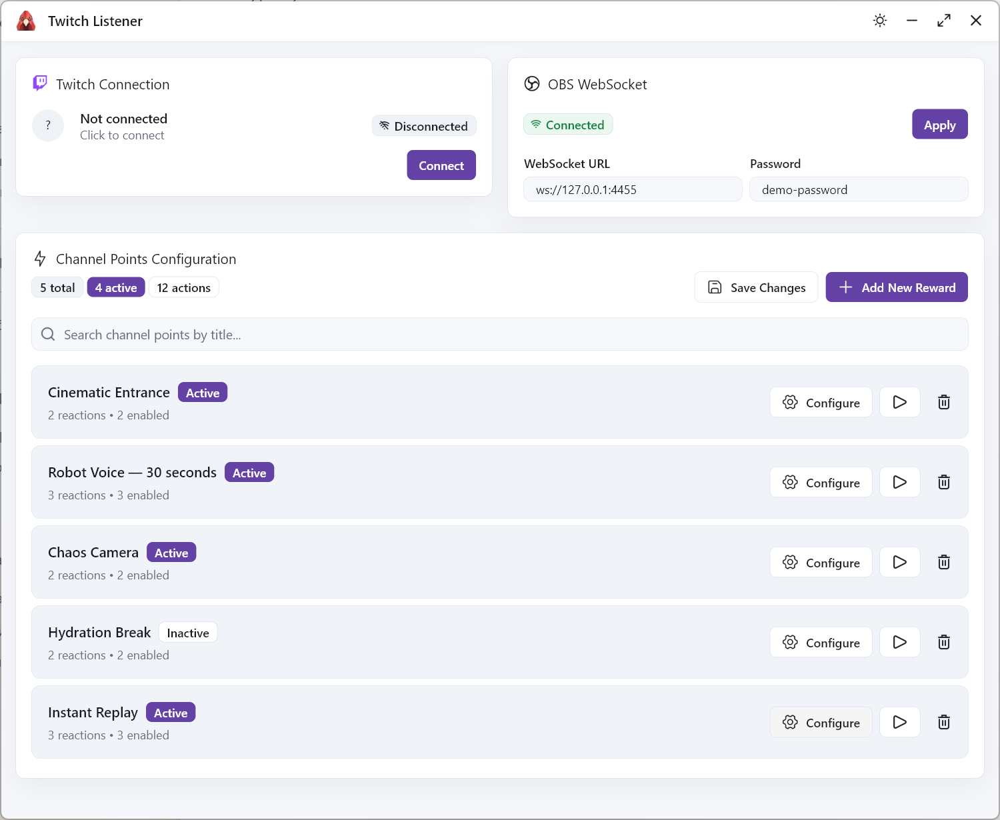
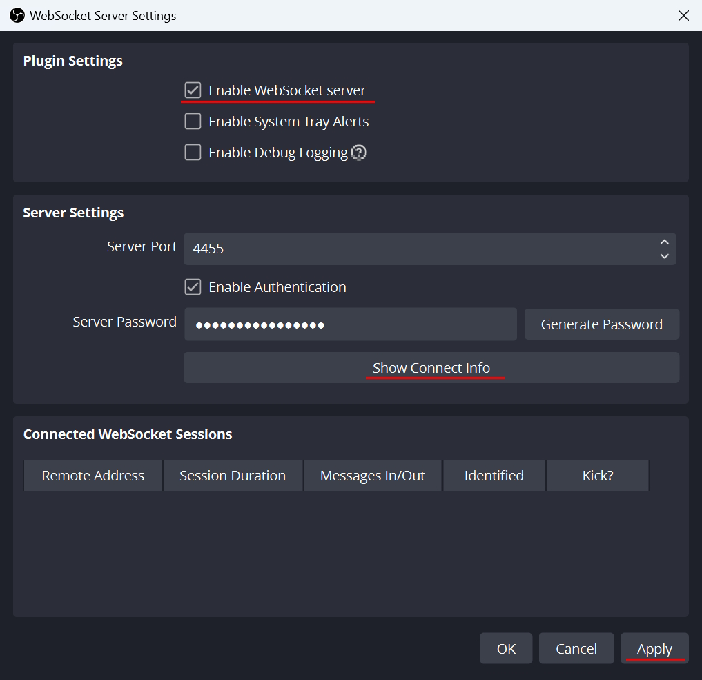
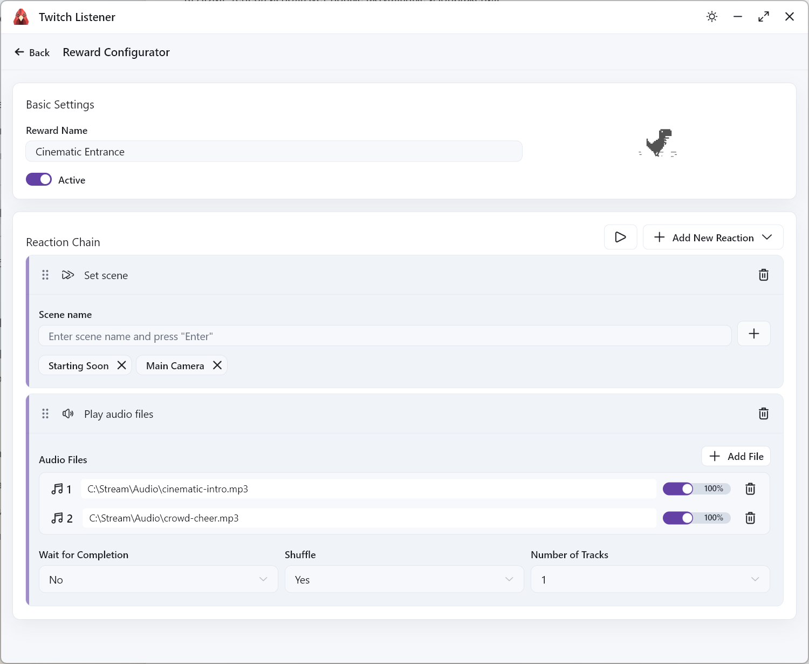
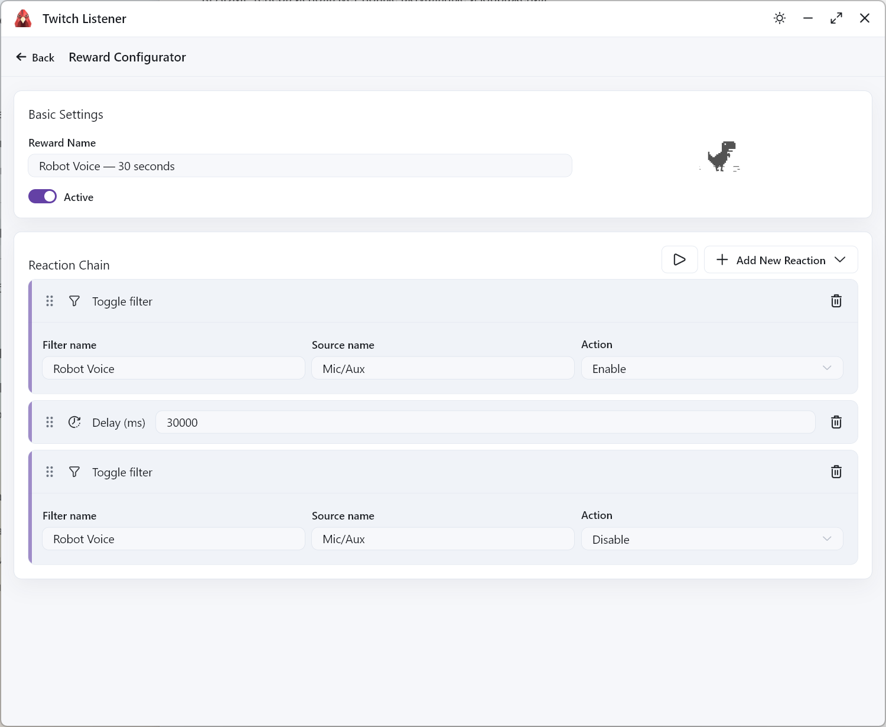
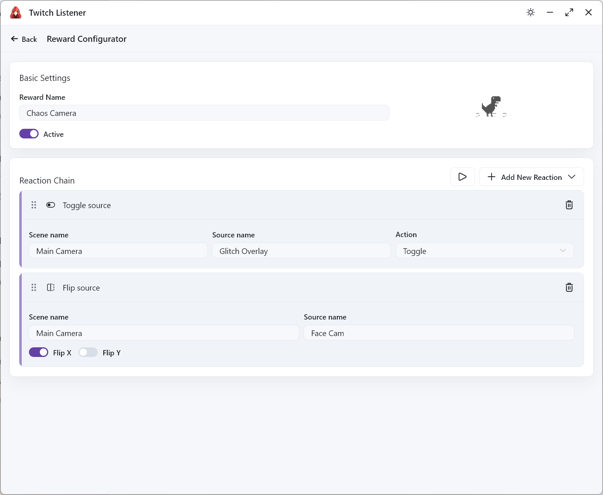

<div align="center">
  

  # Twitch Listener

  **Turn Twitch Channel Point rewards into automated OBS actions.**

  Build reaction chains that change scenes, toggle sources and filters, play audio,
  send input, and more — directly from a lightweight Windows desktop app.

  [](https://flutter.dev/)
  [](https://www.twitch.tv/)
  [](https://obsproject.com/)

  [Download the latest release](https://github.com/dealnotedev/twitch_rewards_app/releases) · [Changelog](CHANGELOG.md) · [Українська інструкція](README_uk.md)
</div>

---



## What it does

Twitch Listener watches your channel for custom Channel Point reward redemptions. Link a reaction chain to a Twitch reward by ID, or match its exact title manually. Linked chains keep working when the reward is renamed.

For example, a **Helium voice** reward can enable an OBS microphone filter, wait two minutes, and disable the filter again — without any manual scene management during the stream.

### Available reactions

| Reaction | What it does |
| --- | --- |
| **Toggle input** | Mutes or unmutes an OBS audio input, such as a microphone. |
| **Delay** | Waits for a configurable number of milliseconds before the next reaction. |
| **Play audio files** | Plays one or more local audio files, with volume, shuffle, track-count, and wait-for-completion options. |
| **Play YouTube Track** | Adds the YouTube link from the viewer's reward message to the shared music queue, then immediately continues the reaction chain. |
| **Toggle filter** | Enables, disables, or toggles an OBS source filter. |
| **Toggle source** | Shows, hides, or toggles a source, including sources inside OBS groups. |
| **Flip source** | Mirrors an OBS source horizontally, vertically, or both. |
| **Set scene** | Switches to the next scene in a configured list. |
| **Send input** | Replays a recorded keyboard/input combination. |
| **Crash process** | Force-terminates a selected Windows process. Use with care. |

Reaction chains and connection settings are stored locally. Reward configurations use SQLite, and older configurations are migrated automatically.

### Music requests

Add **Play YouTube Track** to a reward and enable text input for that reward on
Twitch. Viewers enter a link to a single YouTube video. The queue starts playback
when idle and preserves the current track when a new request arrives. Manual
reward tests ask for a YouTube link before running the chain.

A global bottom panel shows the current track and requester on every page,
including the reward editor. It provides pause/resume, seek, next track, an
expandable queue with removal, and a separate music volume slider. Music volume
is saved between launches and does not change sound-effect volumes. Loading and
errors also appear in the panel; video-specific failures do not stop later requests.
YouTube-wide verification, download blocks and rate limits pause preparation
and keep waiting tracks in the queue.

The queue accepts up to 10 requests including the active track, with a maximum
duration of 10 minutes per track. Live streams and playlists are not supported;
a video URL containing playlist parameters adds only that video. Queue state is
session-only. Downloaded audio is cached under
`%LOCALAPPDATA%/twitch_listener/music-cache`, with a 2 GiB cleanup target; files
used during the current session are protected from cleanup.

The app does not automatically fulfill, cancel, refund, or otherwise settle
music redemptions on Twitch. Playback uses the existing `media_kit` backend and
does not require OBS. Downloaded tracks are normalized to -16 LUFS with FFmpeg
before playback and cached as MP3. See [YouTube tool setup](tools/README.md) for
yt-dlp, Deno and the minimal FFmpeg audio build.

Open a reward's **Play YouTube Track** card and use **Connect YouTube** when
YouTube asks for verification. A separate Edge/Chrome window opens with an
app-owned profile. Play a short public video, complete any verification, leave
its tab open and return to the card to press **Check connection**. The window
closes and the app verifies both metadata and an actual audio download before
saving the session. Waiting requests resume automatically after success; use
**Resume requests** to retry after a temporary rate limit.

The session is local to `%LOCALAPPDATA%/twitch_listener/youtube-session`.
Each downloader process uses its own cookie copy; failed or obsolete runs cannot
overwrite a newer session. **Cancel** keeps the saved session; **Disconnect**
offers to remove it and the dedicated browser profile. Error details include
the downloader version with URLs, local paths and credentials removed.

## Quick start

### 1. Install and sign in

1. Download the newest `.zip` from [GitHub Releases](https://github.com/dealnotedev/twitch_rewards_app/releases).
2. Extract the whole archive to a folder of your choice.
3. Run `twitch_listener.exe`.
4. Select **Login** and approve the requested Twitch permissions in your browser.

Listener runs as a single instance per Windows session. Launching it again
brings the existing window to the foreground and restores it if minimized.

> [!NOTE]
> Twitch authentication uses a temporary callback on `localhost:3000`. If login cannot complete, check whether another application is already using that port or whether a firewall is blocking it.

### 2. Connect OBS

Twitch Listener uses **OBS WebSocket v5**, which is built into OBS Studio 28 and newer.

1. In OBS, open **Tools → WebSocket Server Settings**.
2. Enable the WebSocket server.
3. Keep the default port `4455`, or note your custom port.
4. Select **Show Connect Info** and copy the password.
5. In Twitch Listener, enter `ws://127.0.0.1:4455` and the password, then select **Apply**.
6. Confirm that the OBS status changes to **Connected**.



### 3. Create your first reward chain

1. In Twitch Listener, select **Add New Reward**.
2. In **Basic Settings**, select **Link Twitch reward** to open the full-screen reward catalog.
3. Choose an existing reward and select **Save** in the toolbar, or use **Create reward** to create and link a new reward on Twitch. Search, filter by **Created by Listener** or **Without reactions**, and edit rewards that Twitch allows Listener to manage.
4. Add reactions in the order they should run.
5. Save the configuration and ensure the reward is active.
6. Use the play button to test the chain before going live.

The linked name is read-only in Basic Settings and follows the reward on Twitch.
Use **Change link** to choose another reward or **Unlink** to return to matching by
the last known name; both preserve the reaction chain. A missing linked reward
stays linked and never falls back to title matching automatically. You can also
leave a chain unlinked and enter the title **exactly as it appears on Twitch**.

Creating and editing rewards requires Twitch reward-management permission. Existing
connections can still select rewards; use **Reconnect Twitch** in the catalog to
grant the additional permission.

> [!TIP]
> OBS scene, source, input, and filter names must also match exactly. Test each chain with OBS connected before relying on it during a stream.

## Example reward chains

### Cinematic entrance

Cycle from **Starting Soon** to **Main Camera**, then randomly play one of several intro sounds. The audio reaction can also control per-file volume, shuffle mode, track count, and whether the chain waits for playback to finish.



### Temporary voice filter

Enable an OBS microphone filter, keep it active for 30 seconds, and disable it automatically:

1. Add a voice filter to your microphone in OBS and leave it disabled.
2. Add **Toggle filter → Enable** for the microphone and filter.
3. Add a **Delay** of `30000` ms.
4. Add **Toggle filter → Disable** for the same filter.
5. Save and test the chain.



### Camera chaos

Toggle a glitch overlay and mirror the face camera horizontally. Sources inside OBS groups are supported, so the visible scene can stay neatly organized.



### More ideas

| Reward idea | Suggested reaction chain |
| --- | --- |
| **Instant Replay** | Show replay overlay → delay 10 seconds → hide replay overlay |
| **Hydration Break** | Play reminder audio → delay → switch to a short break scene |
| **Jumpscare** | Play randomized audio → briefly show an overlay → hide it again |
| **Chat controls the camera** | Send a keyboard shortcut → delay → send the shortcut again |

## Safety notes

- **Crash process** terminates a process immediately and may cause unsaved work or system instability. Avoid critical Windows, OBS, and broadcast-related processes.
- **Send input** controls the active Windows session. Make sure the intended window will have focus when the reaction runs.
- The app stores Twitch credentials and the OBS WebSocket password locally on the computer. Do not share your application-data files or screenshots containing secrets.
- Keep a manual fallback available for scene and audio control during a live broadcast.

## Development

### Requirements

- Windows 10 or 11
- Flutter stable `>=3.47.0` with Dart `>=3.13.0 <4.0.0`
- Visual Studio with the **Desktop development with C++** workload
- OBS Studio 28+ for integration testing

### Run locally

```powershell
flutter pub get
flutter run -d windows
```

The Windows runner selects the Skia renderer by disabling Impeller in
`windows/runner/main.cpp`. This applies to debug, profile, and release builds.

### Quality checks

```powershell
flutter analyze
flutter test
```

### Build a release

```powershell
$env:NO_OPUS_OGG_LIBS = "1"
flutter build windows --release
```

The release bundle is generated in `build\windows\x64\runner\Release`. Distribute the complete folder, not only the `.exe`, because the application depends on the DLLs and data files beside it.

Release builds use AOT code and must not include `data/flutter_assets/kernel_blob.bin`.
The Windows build removes this file from both Listener and its updater in Release
configuration. The packaging script also rejects archives containing it.

After building Release, check single-instance startup and window activation with:

```powershell
./test/windows/single_instance_smoke.ps1
```

To build a full distribution including the standalone updater and the separate
update package, run `./tools/build_release.ps1`. See [updater setup](updater/README.md).
Install the full `Release.zip` once; subsequent updates can be opened from the
banner between Twitch/OBS connection settings and the reward list. Launch updates
while Listener is idle. The updater retains saved settings and accepts the active
application language and light/dark theme.

## Project structure

```text
lib/
├── actions/          # Reaction editors and action-specific UI
├── obs/              # OBS WebSocket connection and commands
├── twitch/           # OAuth, Twitch API, and EventSub WebSocket handling
├── reward*.dart      # Reward model, configuration, execution, and storage
└── main.dart         # Application entry point and event coordination
test/                 # Automated tests
windows/              # Native Windows runner
assets/               # Runtime icons and bundled assets
images/               # Documentation screenshots
```

## Troubleshooting

<details>
<summary><strong>Twitch login does not return to the app</strong></summary>

Close anything using port `3000`, allow the app through the firewall, and try **Login** again. Keep the app open while completing authorization in the browser.
</details>

<details>
<summary><strong>OBS remains disconnected</strong></summary>

Check that the WebSocket server is enabled, the URL starts with `ws://`, the port matches OBS, and the password has no extra spaces. For a local OBS instance, try `ws://127.0.0.1:4455`.
</details>

<details>
<summary><strong>A reward is redeemed but nothing happens</strong></summary>

Verify that Twitch and OBS are connected, the reward is active, and its title exactly matches the Twitch reward. Then test the chain with the play button and check every OBS object name.
</details>

<details>
<summary><strong>The built application does not start on another PC</strong></summary>

Copy the entire release folder. A standalone `twitch_listener.exe` is not a complete Windows build.
</details>

---

<div align="center">
  Built with Flutter, Twitch EventSub, and OBS WebSocket.
</div>

### Display the Listener player in OBS

Listener publishes its music queue and playback controls at
`http://127.0.0.1:47822` while running. In the Flutter OBS overlay, open
**Overlay settings → Player → Player source → External player** and use port
**47822**. Both Cosmic and Turntable views work. The local OBS player remains
available by selecting **Local player** (its controller port is 47821).

The connection is native HTTP/WebSocket on this computer only, independent of
OBS WebSocket v5. Audio continues playing in Listener; capture its audio in OBS
separately. Closing or hiding an OBS view never stops Listener playback.

The shared contract and native transport are provided by
[`dart_music_player_protocol`](https://github.com/dealnotedev/dart_music_player_protocol),
a standalone Dart package pinned to a tested Git commit. `flutter pub get`
downloads it automatically. Listener can be cloned and built independently of
the OBS overlay; no adjacent package checkout is required. See the package
README for optional local development overrides.
